<!-- PROFILE HEADER -->

  

  

  
  
  

  <a href="#-featured-projects">Projects</a> ·
  <a href="#-technical-skills">Skills</a> ·
  <a href="#-github-activity">GitHub Activity</a> ·
  <a href="#-connect">Connect</a>

---

## 👋 About me

I'm a **Computer Science and Engineering graduate from BRAC University** in Dhaka, Bangladesh. I build backends with **Node.js, Express, and TypeScript**, and use **React and Next.js** to build the interfaces around them.

I enjoy working on the rules behind an API. In RentNest, for example, a tenant can pay only after the landlord approves the rental request. The backend then verifies Stripe's webhook signature before updating the payment status. My Python projects explore a different question: how can someone check the result an application gives them? In DocuMind, readers can follow an answer back to the page it came from.

## 🚀 Featured projects

<table>
  <tr>
    <td width="50%" valign="top">
      <h3>🏠 RentNest</h3>
      
<strong>Full-stack rental marketplace</strong>

      
Tenants search properties and submit rental requests. Landlords approve requests, and tenants pay through Stripe Checkout. The Express API enforces role permissions and verifies payment webhooks. A Next.js dashboard gives each user access to the actions their role allows.

      
<code>TypeScript</code> <code>Express</code> <code>PostgreSQL</code> <code>Prisma</code> <code>Next.js</code> <code>Stripe</code>

      

        <a href="https://github.com/SajidurCodes/RentNest"><strong>Backend ↗</strong></a> ·
        <a href="https://github.com/SajidurCodes/RentNest-Frontend">Frontend</a> ·
        <a href="https://rent-nest-frontend-theta.vercel.app/">Live demo</a>
      

    </td>
    <td width="50%" valign="top">
      <h3>🗺️ Tour Management System</h3>
      
<strong>Tour booking and payments in Bangladesh</strong>

      
Travelers can browse tours, book dates, pay through SSLCommerz, and check their booking status. The backend uses JWT access and refresh tokens. Role-protected routes let administrators manage tours, users, guides, and payments.

      
<code>Node.js</code> <code>Express</code> <code>MongoDB</code> <code>Mongoose</code> <code>React</code> <code>SSLCommerz</code>

      
<a href="https://github.com/SajidurCodes/Tour-Management"><strong>Repository ↗</strong></a>

    </td>
  </tr>
  <tr>
    <td width="50%" valign="top">
      <h3>📄 DocuMind</h3>
      
<strong>Document Q&amp;A with page citations</strong>

      
Upload a PDF or text file and ask a question in the browser. DocuMind retrieves passages by keyword and sends them to a language model through Groq. It preserves PDF page numbers during extraction so readers can check the cited passage themselves.

      
<code>Python</code> <code>FastAPI</code> <code>SQLite</code> <code>Groq</code> <code>Render</code>

      

        <a href="https://github.com/SajidurCodes/DocuMind"><strong>Repository ↗</strong></a> ·
        <a href="https://documind-vc21.onrender.com/">Live demo</a>
      

    </td>
    <td width="50%" valign="top">
      <h3>🔌 DataBridge MCP</h3>
      
<strong>CSV inspection through an API and MCP tools</strong>

      
Exposes CSV inspection through FastAPI and the Model Context Protocol (MCP). An API client or an MCP client can request an inspection. The repository includes profiling benchmarks and a suite of <strong>91 passing tests</strong>.

      
<code>Python</code> <code>FastAPI</code> <code>MCP</code> <code>CSV</code>

      
<a href="https://github.com/SajidurCodes/Databridge-MCP"><strong>Repository ↗</strong></a>

    </td>
  </tr>
  <tr>
    <td width="50%" valign="top">
      <h3>📈 ChurnLens</h3>
      
<strong>Customer churn prediction and model serving</strong>

      
Compared baseline models, evaluated calibration, and selected a decision threshold before serving the frozen model through FastAPI. On the held-out test set, the model achieved <strong>0.9723 ROC-AUC</strong> and <strong>0.8872 average precision</strong>. A fresh checkout passed 78 tests.

      
<code>Python</code> <code>scikit-learn</code> <code>FastAPI</code>

      
<a href="https://github.com/SajidurCodes/ChurnLens"><strong>Repository ↗</strong></a>

    </td>
    <td width="50%" valign="top">
      <h3>💬 LangChain Runnable Chatbot</h3>
      
<strong>Question routing and structured LLM responses</strong>

      
A keyword classifier routes programming, math, and general questions without an extra LLM call. Each route generates an answer, summary, and keywords in parallel. Pydantic validates the response before Streamlit displays it.

      
<code>Python</code> <code>LangChain</code> <code>Pydantic</code> <code>Groq</code> <code>Streamlit</code>

      
<a href="https://github.com/SajidurCodes/LangChain-Chatbot"><strong>Repository ↗</strong></a>

    </td>
  </tr>
</table>

  

## 🛠️ Technical skills

  

| Area | Hands-on experience |
| --- | --- |
| **Backend development** | REST APIs with Node.js, Express, TypeScript, and FastAPI. JWT authentication, role-based authorization, and request validation. |
| **Databases** | Relational modeling with PostgreSQL and Prisma, MongoDB with Mongoose, and SQLite for document storage. |
| **Full-stack development** | React and Next.js dashboards, protected routes, search and filters, and forms with Zod validation. |
| **Payments** | Stripe Checkout, signed payment webhooks, and SSLCommerz booking payments. |
| **AI integration** | Groq API, keyword-based retrieval, page citations, LangChain routing, Pydantic responses, and MCP tools. |
| **Machine learning** | Model comparison, calibration, threshold selection, scikit-learn, and PyTorch fundamentals. |

## 🎓 Education and research

**B.Sc. in Computer Science and Engineering, BRAC University**  
Dhaka, Bangladesh · September 2022 – September 2026

For our undergraduate thesis, my team studied crop-yield prediction under data scarcity. We compared centralized and federated learning using agricultural and climate records, then evaluated how fine-tuning a model for Bangladesh affected its prediction error.

## 📊 GitHub activity

  
  

### 🐍 Contribution snake

  <picture>
    <source media="(prefers-color-scheme: dark)" srcset="https://raw.githubusercontent.com/SajidurCodes/SajidurCodes/output/snake-dark.svg" />
    <source media="(prefers-color-scheme: light)" srcset="https://raw.githubusercontent.com/SajidurCodes/SajidurCodes/output/snake.svg" />
    
  </picture>

## 🧩 Problem solving

  

## 🌐 Connect

  
  
  
  
  

  <em>“My life is like a Christopher Nolan movie — confusing at first, but somehow it all comes together.”</em> 😅

  

